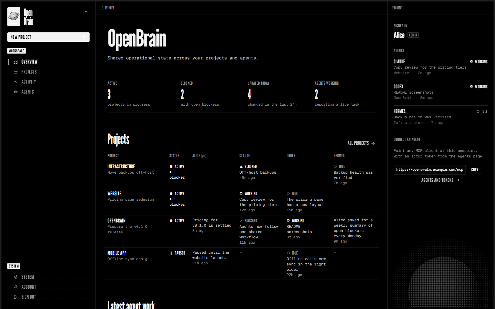
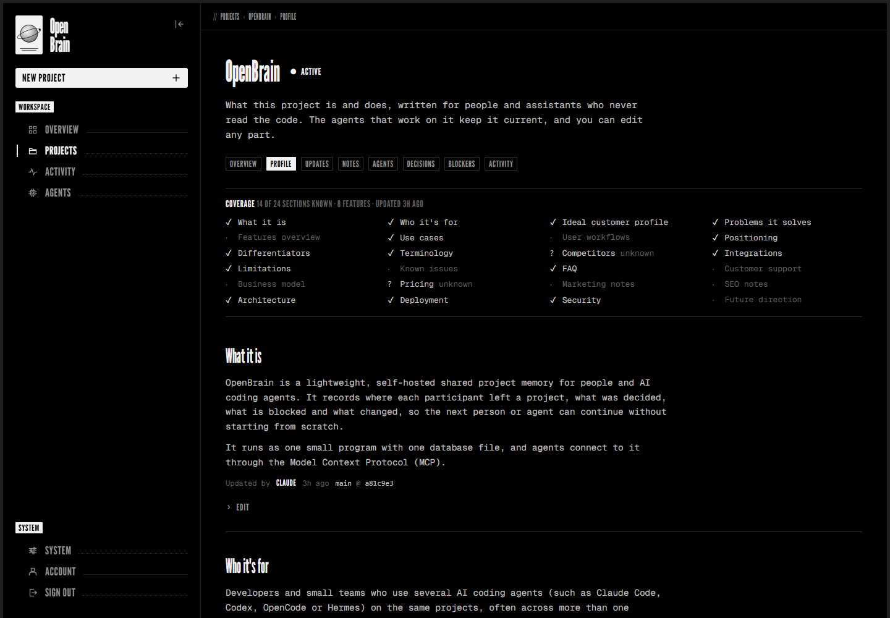
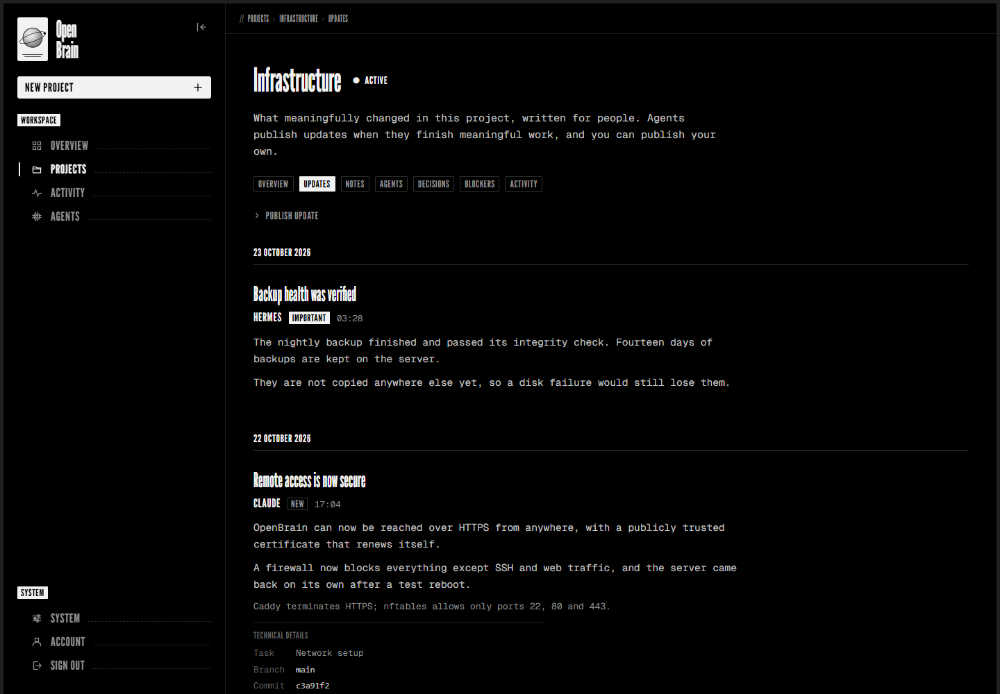

# OpenBrain

**Not another AI memory layer** 
OpenBrain is small self-hosted shared project context layer for humans and AI agents.
Claude Code, Codex, OpenCode, Hermes, OpenClaw and any other MCP
agent can read and write, so every agent knows what each project is, where the
work stands and what changed, without syncing code between machines.

OpenBrain doesn't store chat transcripts and hope semantic search finds the right thing later.

It stores structured project understanding.

A coding agent can inspect a repository once and build a durable Project Profile describing the product, features, audience, integrations, limitations, workflows, and other important context.

After that, agents keep OpenBrain current as they work.



- [What OpenBrain is](#what-openbrain-is)
- [Installation](#installation): server, accounts, agents, first project
- [Everyday use](#everyday-use)
- [Reference](#reference): tools, configuration, commands, security, backups

## What OpenBrain is

If you work on the same projects with several AI agents, each one starts every
session cold. None of them knows what the others did yesterday, what was
decided, or what is blocked. An assistant that never sees the repository, such
as Hermes or OpenClaw that writes your marketing, knows even less about what the
product does.

OpenBrain is where that knowledge lives. It is one Go binary and one SQLite
file on a server you control. You use its **dashboard** in a browser. Agents
use its **MCP server**, each with its own token, so every change shows who
made it.

For each project it keeps three levels of knowledge:

1. **The profile: what the project is.** Overview, audience, problems it
   solves, features, use cases, positioning, integrations, limitations, FAQ.
   A coding agent writes it once by reading the repository. After that, an
   assistant can explain the product, answer customers and draft marketing
   without seeing any code.
2. **The current state: where the work stands.** What each agent is doing,
   where each one stopped (handoffs), decisions to respect, and blockers.
3. **The change history: what changed.** Short, plain-English updates written
   for you ("Login is now faster"), not developer jargon.

```
 Claude Code ─┐                          ┌─ you, in a browser (dashboard)
 Codex ───────┼── MCP over HTTPS ──▶ OpenBrain ◀── HTTPS ─┘
 OpenCode ────┤    (one token each)     one binary + one SQLite file
 Hermes ──────┤
 OpenClaw ────┘
```

| | What it holds |
|---|---|
| **Profile** | What the product **is**: overview, audience, positioning, limitations, FAQ, … |
| **Features** | What it **can do**, from the user's point of view, with a status (planned … removed) |
| **Updates** | What **changed**, in plain English, for the project owner |
| **Handoffs** | Where an agent **left off**: what it did, next steps, branch, commit |
| **Notes** | Durable freeform context |
| **Decisions** | Choices every agent should respect |
| **Blockers** | Things preventing progress |
| **Activity** | Raw history of every change, written automatically |

Unknown facts are marked `unknown` instead of guessed, and every entry shows
who wrote it and when. OpenBrain never stores source code, private reasoning
or chat transcripts. It contains no AI model of its own; your agents do the
thinking and OpenBrain remembers.

| Profile | Updates |
|---------|---------|
|  |  |

## Installation

Seven steps. Steps 1 and 2 happen once; steps 3 to 5 once per agent; step 6
once per project.

1. [Install OpenBrain](#1-install-openbrain): on
   [its own server](#option-a-its-own-server) or on
   [the same computer as your agents](#option-b-the-same-computer-as-your-agents)
2. [Create your administrator account](#2-create-your-administrator-account)
3. [Give each agent its own token](#3-give-each-agent-its-own-token)
4. [Connect your agents](#4-connect-your-agents)
5. [Teach your agents the workflow](#5-teach-your-agents-the-workflow)
6. [Add your first project](#6-add-your-first-project)
7. [Check that everything works](#7-check-that-everything-works)

### 1. Install OpenBrain

First decide where OpenBrain runs. You don't need a separate server: it can
run on the same computer as Hermes, OpenClaw or your coding agents.

| | **A. Its own server** (e.g. a small VPS) | **B. The same computer as your agents** |
|---|---|---|
| Reachable from | Anywhere: every computer, every agent, your phone | Only that computer, unless you add [Tailscale](#reaching-it-from-other-computers) |
| Available | Always | Only while that computer is on and awake |
| Setup | Domain or IP address, HTTPS proxy, firewall | Build it and start it; no HTTPS, proxy or firewall |
| Exposure | On the internet, protected by HTTPS, passwords and tokens | Never leaves the computer |
| Backups | Nightly, automatic | Manual (or Linux's nightly timer) |
| Cost | A small VPS; OpenBrain needs about 30 MB of RAM | Nothing extra |

**Choose A** if your agents run on more than one computer, or you want the
dashboard from anywhere. **Choose B** if your agents share one computer, for
example Hermes and Claude Code on the same PC, or to try OpenBrain out.
Switching later is easy, because everything lives in one database file. Take a
backup with `openbrain backup`, install OpenBrain on the new machine, stop it
there, load the backup with `openbrain restore <file>`, and start it again.
Accounts, tokens and projects all come along, so only the agents' MCP endpoint
changes.

#### Option A: its own server

**You need:** a Linux server with systemd (Debian or Ubuntu work well), root
access, and either a domain name pointing at it or its public IP address. Go
1.25 or newer builds OpenBrain; an older Go downloads the right version by
itself.

**a. Build.**

```sh
git clone https://github.com/Anasou7/openbrain.git
cd openbrain
go test ./...
CGO_ENABLED=0 go build -trimpath -ldflags="-s -w" -o openbrain ./cmd/openbrain
```

While the repository is private, the server needs GitHub access to clone it
(for example `gh auth login` and `gh repo clone Anasou7/openbrain`), or build on
your own computer and copy the `openbrain` binary and the `deploy/` folder over
with `scp`.

**b. Install it as a service.**

```sh
sudo install -m 0755 openbrain /usr/local/bin/openbrain
sudo useradd --system --home-dir /var/lib/openbrain --no-create-home \
  --shell /usr/sbin/nologin openbrain

sudo install -d -m 0750 -o root -g openbrain /etc/openbrain
sudo install -m 0640 -o root -g openbrain deploy/openbrain.env.example /etc/openbrain/env

sudo install -m 0644 deploy/openbrain.service deploy/openbrain-backup.service \
  deploy/openbrain-backup.timer /etc/systemd/system/
```

**c. Choose the address.** OpenBrain can have a host to itself or live under
a path next to other sites. Set `OPENBRAIN_BASE_PATH` in `/etc/openbrain/env`
(`sudoedit /etc/openbrain/env`) to match:

| Your URL will be | `OPENBRAIN_BASE_PATH` |
|------------------|-----------------------|
| `https://brain.example.com/` | `/` (the default) |
| `https://example.com/openbrain/` | `/openbrain` |

Then start it:

```sh
sudo systemctl daemon-reload
sudo systemctl enable --now openbrain.service openbrain-backup.timer
curl -s http://127.0.0.1:8080/ready     # with /openbrain: .../openbrain/ready; expect {"status":"ready"}
```

**d. Add HTTPS.** OpenBrain listens only on `127.0.0.1:8080`, so a reverse
proxy gives it a public HTTPS address. With [Caddy](https://caddyserver.com),
which gets and renews certificates by itself, `/etc/caddy/Caddyfile` is:

```caddy
brain.example.com {
	reverse_proxy 127.0.0.1:8080
}
```

Run `sudo systemctl reload caddy`.
[deploy/Caddyfile.example](deploy/Caddyfile.example) also shows the shared-host
`/openbrain` layout, and a server with **no domain**, which uses a trusted
certificate for its IP address. nginx works too
([deploy/nginx.conf.example](deploy/nginx.conf.example)). On a private network,
Tailscale or an SSH tunnel can replace the proxy
([docs/MCP.md](docs/MCP.md#reaching-the-server)).

**e. Close everything else.** Allow only SSH, HTTP and HTTPS:

```sh
sudo ufw default deny incoming
sudo ufw allow 22/tcp && sudo ufw allow 80/tcp && sudo ufw allow 443/tcp
sudo ufw enable
```

Never expose port 8080. [docs/DEPLOYMENT.md](docs/DEPLOYMENT.md) has the
details: nginx, nftables, trusted proxies, upgrades and restores.

#### Option B: the same computer as your agents

OpenBrain runs on Linux, macOS and Windows. It listens only on `127.0.0.1`
(this computer), so it needs no HTTPS, proxy or firewall changes: nothing
leaves the machine.

**a. Build.** You need [Go](https://go.dev/dl/) 1.25 or newer
(`winget install GoLang.Go` on Windows, `brew install go` on macOS).

```sh
git clone https://github.com/Anasou7/openbrain.git
cd openbrain
go build -o openbrain ./cmd/openbrain          # Windows: go build -o openbrain.exe ./cmd/openbrain
```

While the repository is private, sign in to GitHub first (`gh auth login`) or
clone with `gh repo clone Anasou7/openbrain`.

**b. Start it, and have it start by itself.** OpenBrain keeps everything in
one file, `openbrain.db`, created in the folder it starts in. So give it a
permanent folder.

<details>
<summary><b>Linux</b>: a systemd service</summary>

Follow [Option A](#option-a-its-own-server) steps **b** and **c**, keeping the
default `OPENBRAIN_BASE_PATH=/`, and skip **d** and **e**. OpenBrain then
starts at boot, restarts if it fails, and backs up nightly.
</details>

<details>
<summary><b>macOS</b>: a launch agent</summary>

```sh
mkdir -p ~/OpenBrain && cp openbrain ~/OpenBrain/
cat > ~/Library/LaunchAgents/com.openbrain.server.plist <<EOF
<?xml version="1.0" encoding="UTF-8"?>
<!DOCTYPE plist PUBLIC "-//Apple//DTD PLIST 1.0//EN" "http://www.apple.com/DTDs/PropertyList-1.0.dtd">
<plist version="1.0"><dict>
  <key>Label</key><string>com.openbrain.server</string>
  <key>ProgramArguments</key><array><string>$HOME/OpenBrain/openbrain</string><string>serve</string></array>
  <key>WorkingDirectory</key><string>$HOME/OpenBrain</string>
  <key>RunAtLoad</key><true/>
  <key>KeepAlive</key><true/>
  <key>StandardErrorPath</key><string>$HOME/OpenBrain/openbrain.log</string>
</dict></plist>
EOF
launchctl bootstrap gui/$(id -u) ~/Library/LaunchAgents/com.openbrain.server.plist
```

It now starts whenever you log in and restarts if it stops. Logs go to
`~/OpenBrain/openbrain.log`.
</details>

<details>
<summary><b>Windows</b>: a startup shortcut</summary>

In PowerShell, from the `openbrain` folder:

```powershell
New-Item -ItemType Directory -Force "$env:USERPROFILE\OpenBrain" | Out-Null
Copy-Item openbrain.exe "$env:USERPROFILE\OpenBrain\"

# Start OpenBrain, minimised, whenever you sign in to Windows
$s = (New-Object -ComObject WScript.Shell).CreateShortcut("$([Environment]::GetFolderPath('Startup'))\OpenBrain.lnk")
$s.TargetPath = "$env:USERPROFILE\OpenBrain\openbrain.exe"; $s.Arguments = "serve"
$s.WorkingDirectory = "$env:USERPROFILE\OpenBrain"; $s.WindowStyle = 7
$s.Save()

# Start it now
Start-Process "$env:USERPROFILE\OpenBrain\openbrain.exe" -ArgumentList serve -WorkingDirectory "$env:USERPROFILE\OpenBrain" -WindowStyle Minimized
```

OpenBrain runs in a minimised window on the taskbar; closing that window stops
it. To stop starting it at sign-in, delete `OpenBrain.lnk` from the Startup
folder (`Win+R`, then `shell:startup`).
</details>

**c. Check it.** Open <http://127.0.0.1:8080/> and continue with step 2.
Agents on this computer use `http://127.0.0.1:8080/mcp` as their MCP endpoint
in steps 3 and 4. Plain `http` is fine here, because the traffic never leaves
the computer.

**Good to know with option B:**

- **Run commands from the OpenBrain folder** (`./openbrain backup`,
  `.\openbrain.exe user reset-password <name>`, …), so they use the same
  `openbrain.db`. Or set `OPENBRAIN_DB` to its full path.
- **Back up yourself.** `openbrain backup` writes a safe copy to `backups/`
  next to the database, even while OpenBrain runs. Copy those files to
  another disk or cloud storage now and then. On Linux, the nightly timer does
  the first part for you.
- **Sleep and shutdown:** while the computer sleeps, OpenBrain does too.
  Agents elsewhere get connection errors until it wakes.
- **Hermes or OpenClaw in Docker:** inside a container, `127.0.0.1` is the
  container itself. With Docker Desktop (Windows, macOS), use
  `http://host.docker.internal:8080/mcp`. On Linux, run the container with
  `--network host` and keep `http://127.0.0.1:8080/mcp`.

##### Reaching it from other computers

If you later want a laptop, a second PC or your phone to reach it, don't open
port 8080. Install [Tailscale](https://tailscale.com) on this computer and on
the others, then run `tailscale serve --bg 8080` here. OpenBrain is then
available, with HTTPS, only to your own devices at
`https://<this-computer>.<your-tailnet>.ts.net/`, and agents use that address
plus `/mcp`. Details are in [docs/MCP.md](docs/MCP.md#reaching-the-server). If
your agents end up on several computers, option A is usually simpler.

### 2. Create your administrator account

Open your URL straight away: for example `https://brain.example.com/` with
option A, or <http://127.0.0.1:8080/> with option B. A new install sends you
to **setup**: choose a username, a display name and a
password (8+ characters). That first account is the administrator, and you're
signed in immediately. Until you do this, whoever opens the page first gets
the account.

Other people can get their own accounts later, from the **System** page.

### 3. Give each agent its own token

Every agent gets its own identity (an *actor*) and a token, so the dashboard
can show who did what. On the dashboard's **Agents** page:

1. **Add an actor**: slug `claude`, display name `Claude`, kind `agent`.
2. **Create a token**: pick the actor and a label for the machine, such as
   `laptop`. The token (`obt_…`) is **shown once**, so copy it now.
3. Repeat for each agent, for example `codex`, `opencode`, `hermes` and
   `openclaw`. Give each machine its own token, so you can revoke one without
   touching the others.

The **MCP endpoint** shown at the top of the Agents page is the URL your
agents connect to: for example `https://brain.example.com/mcp`, or
`http://127.0.0.1:8080/mcp` with option B.

<details>
<summary>The same from a shell</summary>

On a Linux service (option A, or option B on Linux):

```sh
DB=/var/lib/openbrain/openbrain.db
sudo -u openbrain env OPENBRAIN_DB=$DB openbrain actor create claude --name "Claude"
sudo -u openbrain env OPENBRAIN_DB=$DB openbrain token create --actor claude --label laptop
```

On macOS or Windows (option B), from the OpenBrain folder:
`./openbrain actor create claude --name "Claude"`, then
`./openbrain token create --actor claude --label laptop` (`.\openbrain.exe` on
Windows).
</details>

On each computer where an agent runs, store its token in an environment
variable. The configurations below read `OPENBRAIN_MCP_TOKEN`, so the token
never sits in a config file:

```sh
# macOS / Linux: add to ~/.profile or ~/.zshrc, then open a new terminal
export OPENBRAIN_MCP_TOKEN='obt_…'
```
```powershell
# Windows: then open a new terminal
setx OPENBRAIN_MCP_TOKEN "obt_…"
```

**Several agents on one computer?** Each still needs its own token, so give
each its own variable, for example `OPENBRAIN_CLAUDE_TOKEN`,
`OPENBRAIN_CODEX_TOKEN` and `OPENBRAIN_HERMES_TOKEN`, and use that name in its
configuration in step 4. Don't rely on a `.env` file to override a shared
`OPENBRAIN_MCP_TOKEN`: a variable already set in the environment usually wins,
and every agent would then write as the same actor.

### 4. Connect your agents

In every example, replace `https://brain.example.com/mcp` with your MCP
endpoint from step 3 (`http://127.0.0.1:8080/mcp` with option B). If you gave
an agent its own variable name, use that instead of `OPENBRAIN_MCP_TOKEN`.

**Claude Code**

```sh
claude mcp add-json --scope user openbrain \
  '{"type":"http","url":"https://brain.example.com/mcp","headers":{"Authorization":"Bearer ${OPENBRAIN_MCP_TOKEN}"}}'
claude mcp list        # expect: openbrain ... ✔ Connected
```

Keep the single quotes: Claude Code fills in `${OPENBRAIN_MCP_TOKEN}` itself
when it connects.

**Codex**: in `~/.codex/config.toml`

```toml
[mcp_servers.openbrain]
url = "https://brain.example.com/mcp"
bearer_token_env_var = "OPENBRAIN_MCP_TOKEN"
```

Check it with `codex mcp list`.

**OpenCode**: in `~/.config/opencode/opencode.json`

```json
{
  "$schema": "https://opencode.ai/config.json",
  "mcp": {
    "openbrain": {
      "type": "remote",
      "url": "https://brain.example.com/mcp",
      "oauth": false,
      "headers": { "Authorization": "Bearer {env:OPENBRAIN_MCP_TOKEN}" }
    }
  }
}
```

Check it with `opencode mcp list`.

**Hermes**: in `config.yaml` in your Hermes home (`~/.hermes/`, or
`%LOCALAPPDATA%\hermes\` on Windows)

```yaml
mcp_servers:
  openbrain:
    url: "https://brain.example.com/mcp"
    headers:
      Authorization: "Bearer ${OPENBRAIN_MCP_TOKEN}"
```

Put `OPENBRAIN_MCP_TOKEN=obt_…` in the `.env` file next to it. If you use
Hermes profiles, each profile folder (`profiles/<name>/`) has its own
`config.yaml` and `.env`, so repeat this for every profile that should see
OpenBrain. Check it with `hermes mcp test openbrain`, which should report
`Tools discovered: 19`.

**OpenClaw**: in `~/.openclaw/openclaw.json`, or **Settings → MCP → Add
server** in the Control UI (transport: Streamable HTTP)

```json5
{
  mcp: {
    servers: {
      openbrain: {
        url: "https://brain.example.com/mcp",
        transport: "streamable-http",
        headers: { Authorization: "Bearer ${OPENBRAIN_MCP_TOKEN}" },
      },
    },
  },
}
```

Put `OPENBRAIN_MCP_TOKEN=obt_…` in `~/.openclaw/.env`. Check it with
`openclaw mcp doctor openbrain --probe`, which should list 19 tools.

**Any other MCP client**: use Streamable HTTP, your MCP endpoint, and the
header `Authorization: Bearer <token>`.

Restart each agent after changing its configuration.
[docs/MCP.md](docs/MCP.md#client-configuration) has project-level variants and
troubleshooting.

#### Hermes or OpenClaw: what differs

Both are personal assistants rather than coding agents, and both use
OpenBrain the same way: they read a project's profile, state and updates, and
answer from them. What differs is the setup:

| | Hermes | OpenClaw |
|---|---|---|
| Configuration | `config.yaml` in the Hermes home, key `mcp_servers` | `~/.openclaw/openclaw.json`, key `mcp.servers`, with `transport: "streamable-http"`; or Settings → MCP |
| Token file | `.env` next to `config.yaml` | `~/.openclaw/.env` |
| One identity or several | Each Hermes profile has its own `config.yaml` and `.env`, so each profile can be its own OpenBrain actor | MCP servers are set once per gateway, so every OpenClaw agent on it writes as the same actor; name it after the gateway, e.g. `openclaw` |
| Instructions go in | `SOUL.md` | `AGENTS.md` in the workspace (`~/.openclaw/workspace/`). `SOUL.md` there is for persona and tone |
| Tool access | All 19 tools once connected | Tools appear as `openbrain__get_project_profile` and so on. The `coding` and `messaging` tool profiles include them; `minimal` hides them |
| Applying changes | Restart Hermes | The gateway picks changes up on the next turn; restart it if not |
| Check | `hermes mcp test openbrain` | `openclaw mcp doctor openbrain --probe` |

Either way, anyone who can message your assistant can ask it about your
projects and, through it, add notes. Keep its chat access limited to people
you trust.

### 5. Teach your agents the workflow

Connecting gives an agent the tools. A short instruction block tells it when
to use them: read the project before working, leave a handoff when stopping,
keep the profile true. Paste the block below the line in each file into the
agent's standing instructions:

| Agent | Paste this | Into |
|-------|-----------|------|
| Claude Code | [docs/clients/CLAUDE.md](docs/clients/CLAUDE.md) | `~/.claude/CLAUDE.md` (all projects) or a repository's `CLAUDE.md` |
| Codex | [docs/clients/CODEX.md](docs/clients/CODEX.md) | `~/.codex/AGENTS.md` or a repository's `AGENTS.md` |
| OpenCode | [docs/clients/OPENCODE.md](docs/clients/OPENCODE.md) | `~/.config/opencode/AGENTS.md` or a repository's `AGENTS.md` |
| Hermes | [docs/clients/HERMES.md](docs/clients/HERMES.md) | `SOUL.md` in your Hermes home (and in each profile you use) |
| OpenClaw | [docs/clients/HERMES.md](docs/clients/HERMES.md) (the same block) | `AGENTS.md` in the OpenClaw workspace, `~/.openclaw/workspace/` (and in each agent's workspace if you run several) |
| Anything else | [docs/clients/GENERIC.md](docs/clients/GENERIC.md) | wherever it keeps standing instructions |

The coding agents' block covers working on code. The assistant block, for
Hermes and OpenClaw, makes the assistant answer only from what OpenBrain
contains, and ask you before it acts on a change, for example by drafting an
announcement.

### 6. Add your first project

Open a terminal in the project's repository, start a coding agent (Claude
Code, Codex or OpenCode) and ask:

> Fully add this project to OpenBrain.

The agent registers the repository, then reads the README, docs, app routes,
CLI, API, configuration and deployment files. It writes the project's profile
in one go: what the product is, who it's for, every user-facing feature, its
integrations and limitations. Anything the repository doesn't show, such as
pricing, is marked `unknown` rather than guessed. Open the project's
**Profile** page on the dashboard to read what it wrote. You can edit or fill
in any section yourself.

You can also create a project by hand: **Projects → New project** on the
dashboard, with its name and, ideally, its repository URL so agents recognise
it. Then ask an agent to build the profile as above.

Repeat this for each project. From then on, agents pick the project up by
themselves whenever they work in that repository.

### 7. Check that everything works

- **Dashboard → Agents:** each token shows *last used* after its agent's
  first call.
- **Ask any agent:** "What projects are in OpenBrain?" It should list them,
  using `list_projects` or `get_overview`.
- **Ask Hermes or OpenClaw:** "What is <project> and who is it for?", then
  "What changed recently?" The answers should come from the profile and the
  updates.
- **After a coding session:** the project page shows the agent's state, its
  handoff, and an update if something meaningful changed.

A token can be checked without any agent:

```sh
curl -s -H "Authorization: Bearer $OPENBRAIN_MCP_TOKEN" https://brain.example.com/api/whoami
```

A `401` means the token is wrong, revoked or not set in that terminal.

## Everyday use

With the instructions from step 5, agents follow this loop by themselves:

```
find_project → get_project_context → set_agent_state(working)
  → work, recording decisions / blockers / notes that will matter later
  → if a durable product fact changed: update_project_knowledge / upsert_project_feature
  → record_handoff (summary, next steps, branch, commit)
      + a plain-English update, only if something meaningful changed for you
  → final state (finished, idle, blocked or waiting)
```

Your part is the dashboard:

- **Overview:** every project against every person and agent, with each
  one's latest meaningful work.
- **Project page:** a product snapshot, the latest update, agent states,
  handoffs, decisions, blockers and notes. You can add notes, decisions,
  blockers, handoffs and updates yourself; they're attributed to you.
- **Profile:** the full description of the product. Edit any section or
  feature; fill in what agents marked `unknown`.
- **Updates:** what changed, grouped by day like patch notes.

[docs/AGENT_WORKFLOW.md](docs/AGENT_WORKFLOW.md) explains the workflow in
full, including how agents keep the profile up to date and how Hermes answers
questions about a project.

## Reference

### MCP tools

| Tool | Purpose |
|------|---------|
| `find_project` | Identify the project from a git remote, ID or slug |
| `get_project_profile` | What the project is and does: the whole profile, one section, or one feature |
| `get_project_context` | The current state: everything needed to resume work |
| `get_project_updates` | What changed, newest first, paged |
| `get_project_history` | Older handoffs, decisions, notes or activity, paged |
| `get_overview` | All projects, where each participant left them, and recent updates |
| `list_projects`, `register_project`, `update_project` | Browse and manage projects |
| `sync_project_profile` | Write a comprehensive profile in one call |
| `update_project_knowledge`, `upsert_project_feature` | Keep one section or feature true when a durable fact changes |
| `set_agent_state` | Your current state and task |
| `record_handoff` | Where you left the project, optionally with a project update |
| `publish_project_update` | Tell the project owner what meaningfully changed |
| `record_decision`, `add_note` | Durable decisions and notes |
| `raise_blocker`, `resolve_blocker` | Track blockers |

Full descriptions and schemas: [docs/MCP.md](docs/MCP.md). Scripts can use the
REST API instead: [docs/API.md](docs/API.md).

### Configuration

Set in `/etc/openbrain/env`, then `sudo systemctl restart openbrain`.

| Variable | Default | Meaning |
|----------|---------|---------|
| `OPENBRAIN_DB` | `openbrain.db` | SQLite database file |
| `OPENBRAIN_ADDR` | `127.0.0.1:8080` | Listen address; keep it private |
| `OPENBRAIN_BASE_PATH` | `/` | URL prefix; must match the proxy |
| `OPENBRAIN_TRUSTED_PROXIES` | `127.0.0.1,::1` | Proxies whose `X-Forwarded-*` headers are believed |
| `OPENBRAIN_TOKEN` | *(unset)* | Optional admin API token for scripts; agents never need it |
| `OPENBRAIN_STALE_AFTER` | `1h` | When a busy agent state counts as stale |
| `OPENBRAIN_LOG_FORMAT`, `OPENBRAIN_LOG_LEVEL` | `text`, `info` | Logging |

### Commands

Run them as the service user, for example
`sudo -u openbrain env OPENBRAIN_DB=/var/lib/openbrain/openbrain.db openbrain user list`.

| Command | Does |
|---------|------|
| `openbrain serve` | Run the server (applies migrations first) |
| `openbrain user create <name> [--admin]` | Create an account; prints a generated password once |
| `openbrain user reset-password <name>` | Recover a lost password |
| `openbrain actor create <slug>`, `openbrain token create --actor <slug>` | Register an agent and issue its token |
| `openbrain token list`, `openbrain token revoke <id>` | Manage tokens |
| `openbrain backup`, `openbrain restore <file>` | Consistent online backup, and restore |
| `openbrain version` | Print the version |

### Upgrading

```sh
cd openbrain && git pull
CGO_ENABLED=0 go build -trimpath -ldflags="-s -w" -o openbrain ./cmd/openbrain
sudo systemctl start openbrain-backup.service          # back up first
sudo cp -p /usr/local/bin/openbrain /usr/local/bin/openbrain.prev
sudo install -m 0755 openbrain /usr/local/bin/openbrain
sudo systemctl restart openbrain
```

Database changes apply automatically on start. With option B on macOS or
Windows, back up, copy the new binary over the old one in the OpenBrain
folder, and restart it: on macOS
`launchctl kickstart -k gui/$(id -u)/com.openbrain.server`; on Windows, close
its window and start it again.

### Security

| Who | Credential | Reaches |
|-----|------------|---------|
| People | Username and password, then a browser session | The dashboard |
| Agents | Their own actor token (`obt_…`) | MCP; every write is attributed to the agent |
| Admin scripts | `OPENBRAIN_TOKEN` (optional, powerful) | The REST API |

They don't substitute for each other: a browser session can't call the API or
MCP, and `/mcp` refuses the admin token. Passwords are hashed with Argon2id;
sessions and tokens are stored only as hashes; sign-in is rate limited. Use
HTTPS or a private network, and never commit a token. To report a
vulnerability, see [SECURITY.md](SECURITY.md).

### Backups

The bundled timer writes a verified snapshot every night to
`/var/lib/openbrain/backups/` and keeps 14 days.
`sudo systemctl start openbrain-backup.service` takes one now. Copy backups
off the machine for anything important;
[docs/DEPLOYMENT.md](docs/DEPLOYMENT.md#restore) shows how to restore.

### Resource use

About 20–30 MB of RAM and no background CPU. Typical requests take 3–5 ms on a
2 vCPU VM. The systemd unit caps memory at 64 MB (soft) and 96 MB (hard).

### Documentation

- [docs/DEPLOYMENT.md](docs/DEPLOYMENT.md): installation in depth, proxies,
  firewall, accounts, backups, upgrades
- [docs/MCP.md](docs/MCP.md): connecting agents, every tool, troubleshooting
- [docs/AGENT_WORKFLOW.md](docs/AGENT_WORKFLOW.md): how agents and assistants
  should use OpenBrain
- [docs/API.md](docs/API.md): the REST API
- [docs/ARCHITECTURE.md](docs/ARCHITECTURE.md): data model, authentication,
  concurrency
- [CHANGELOG.md](CHANGELOG.md), [CONTRIBUTING.md](CONTRIBUTING.md),
  [SECURITY.md](SECURITY.md)

## License

[MIT](LICENSE)
